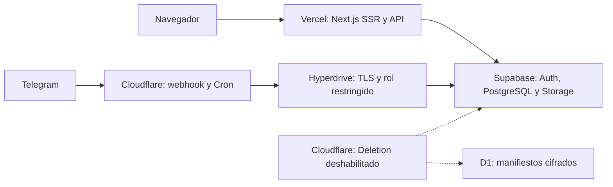

<p align="center">
  
</p>

<h1 align="center">Finzi</h1>

<p align="center">
  Tus cuentas, movimientos y compromisos financieros en un solo lugar.
  <br />
  Finanzas personales gratuitas, sin publicidad ni suscripciones.
</p>

<p align="center">
  
  
  
  
</p>

<p align="center">
  <a href="#funcionalidades">Funcionalidades</a> ·
  <a href="#tecnologías">Tecnologías</a> ·
  <a href="#instalación-local">Instalación</a> ·
  <a href="#documentación-técnica">Documentación</a>
</p>

---

## Acerca del proyecto

**Finzi** es una aplicación web de finanzas personales para registrar el dinero que entra y sale, consultar saldos y organizar compromisos de pago. Reúne cuentas, categorías, movimientos, estadísticas, deudas y gastos fijos en una interfaz en español adaptada a escritorio y móvil.

Es un proyecto de uso personal y de portafolio, sin fines comerciales.

Trabaja con **soles peruanos (PEN) y dólares estadounidenses (USD)** por separado. La información financiera proviene de los registros del usuario: la aplicación no incluye un modo de demostración ni saldos ficticios.

> **Estado:** despliegue personal completado en Vercel + Supabase + Cloudflare. Accede a [Finzi](https://finzi-beta.vercel.app) o a [@FinziAssistantBot](https://t.me/FinziAssistantBot). El procesamiento cloud de eliminaciones permanece deshabilitado por decisión operacional.

## Funcionalidades

| Módulo | Qué puedes hacer |
| --- | --- |
| **Inicio** | Consultar saldo actual, ingresos, gastos y flujo del período; explorar evolución, categorías, cuentas, compromisos pendientes y movimientos recientes. |
| **Cuentas** | Registrar efectivo, cuentas bancarias, ahorros y otras cuentas personales; gestionar aperturas, archivar y transferir entre cuentas de la misma moneda. |
| **Movimientos** | Registrar ingresos y gastos en modales, buscar y filtrar automáticamente, consultar el detalle, duplicar, corregir, archivar o eliminar con trazabilidad. |
| **Categorías** | Organizar ingresos y gastos con categorías y subcategorías, iconos, colores e imágenes privadas. |
| **Estadísticas** | Comparar períodos, consultar ingresos, gastos, balance neto y ahorro calculado; explorar gráficos interactivos y variaciones por categoría. |
| **Deudas** | Registrar acreedor, importe y vencimiento; gestionar abonos y consultar el historial de pagos. |
| **Gastos fijos** | Organizar pagos semanales, quincenales, mensuales, trimestrales o anuales; consultar vencimientos en tarjetas, lista o calendario. |
| **Mi perfil** | Editar nombre, moneda preferida y zona horaria, con confirmación del efecto sobre la agrupación del historial. |
| **Sesión y seguridad** | Registrarse, verificar correo, recuperar o cambiar contraseña y cerrar la sesión actual o todas las sesiones. |
| **Telegram opcional** | Registrar ingresos/gastos con confirmación y consultar saldos/reportes desde un chat privado vinculado; permisos de registro y consulta independientes. |
| **Mis datos** | Descargar una copia personal en JSON o movimientos filtrados en CSV; solicitar la eliminación de la cuenta y seguir su estado con un comprobante privado. |

Los pagos de deudas y gastos fijos permiten **crear un gasto o vincular uno existente**, para conservar la relación con Movimientos y evitar descontar el dinero dos veces. La recurrencia genera los siguientes vencimientos; no realiza cargos bancarios automáticos.

La interfaz ofrece **tema claro, oscuro y automático según el sistema**, con la preferencia conservada en este navegador.

## Tecnologías

| Área | Herramientas |
| --- | --- |
| Aplicación web | Next.js 16, React 19 y TypeScript 6 |
| Datos y autenticación | Supabase Auth, PostgreSQL 17, Supabase Storage y SDK/RPC sin ORM |
| Interfaz | CSS, Lucide React y tipografía Manrope servida localmente |
| Validación | Zod |
| Pruebas | Vitest y Playwright |
| Calidad | ESLint y comprobación de tipos con TypeScript |
| Entorno local | Node.js 24, pnpm 12.14.0 y Docker |

Las versiones exactas y los scripts se encuentran en [package.json](package.json); las dependencias están fijadas en [pnpm-lock.yaml](pnpm-lock.yaml).

## Documentación técnica

### Arquitectura

Finzi es un **monolito modular**. Next.js integra las rutas web y los endpoints HTTP; los módulos separan presentación, lógica de dominio e infraestructura. PostgreSQL mantiene las reglas de integridad y las operaciones financieras atómicas mediante funciones RPC y migraciones SQL versionadas.

```text
finzi/
├── src/
│   ├── app/                  # Rutas, endpoints HTTP, estilos globales y recursos
│   ├── modules/
│   │   ├── accounts/         # Cuentas, aperturas y saldos
│   │   ├── classification/   # Categorías, subcategorías e imágenes
│   │   ├── debts/            # Deudas y abonos
│   │   ├── fixed-expenses/   # Compromisos recurrentes y pagos
│   │   ├── identity/         # Acceso, perfil, seguridad y datos personales
│   │   ├── reporting/        # Inicio, estadísticas y consultas agregadas
│   │   └── transactions/     # Movimientos, transferencias y correcciones
│   └── shared/               # Dinero, fechas y componentes compartidos
├── supabase/                 # Configuración local y migraciones SQL
├── scripts/                  # Entorno local y procesamiento de eliminaciones
├── tests/                    # Pruebas unitarias, de integración y E2E
├── .env.example              # Variables de configuración
└── package.json              # Dependencias y comandos
```

### Reglas financieras y privacidad

- **Importes exactos:** dinero representado con tipos decimales en PostgreSQL y unidades menores enteras con `bigint` en el dominio.
- **Monedas separadas:** los reportes no suman PEN con USD y no existe conversión automática.
- **Transferencias internas:** mueven dinero entre cuentas; no se cuentan como ingresos o gastos.
- **Historia trazable:** las correcciones conservan el registro original y enlazan su reemplazo. Eliminar un movimiento retira su efecto y mantiene el rastro financiero.
- **Operaciones atómicas e idempotentes:** las partidas se confirman juntas y los reintentos técnicos no duplican operaciones.
- **Aislamiento por usuario:** identidad verificada, Row Level Security (RLS), referencias propias y validación en servidor y base de datos.
- **Acciones sensibles:** cambiar contraseña, exportar y eliminar requieren la autorización correspondiente. Las autorizaciones son temporales y de un solo uso.

El ahorro estadístico es el excedente positivo de ingresos menos gastos del período. **No representa el saldo de las cuentas ni dinero reservado.**

## Instalación local

### Requisitos

- **Node.js 24**.
- **pnpm 12.14.0**.
- **Docker** instalado y en ejecución para Supabase local.

No necesitas contratar un proyecto de Supabase para ejecutar el entorno local. La primera ejecución descarga las imágenes de sus servicios.

### Puesta en marcha

Clona este repositorio y abre su carpeta en una terminal. Después ejecuta:

```sh
pnpm install --frozen-lockfile
pnpm supabase:start
pnpm supabase:env
pnpm dev
```

| Servicio | Dirección local |
| --- | --- |
| Aplicación | [http://127.0.0.1:3000/login](http://127.0.0.1:3000/login) |
| Buzón de correo de desarrollo | [http://127.0.0.1:17324](http://127.0.0.1:17324) |
| API de Supabase | `http://127.0.0.1:17321` |
| PostgreSQL | Puerto `17322` |

Registra una identidad de prueba, confirma el correo desde el buzón local, configura tus preferencias y crea tu primera cuenta. Para desarrollo y pruebas utiliza datos sintéticos, por ejemplo direcciones `example.test`.

### Variables de entorno

`pnpm supabase:env` genera `.env.local` a partir del entorno local iniciado y **no sobrescribe un archivo existente**. La plantilla disponible es [.env.example](.env.example).

| Variable | Uso |
| --- | --- |
| `SUPABASE_URL` | URL de la API de Supabase. |
| `SUPABASE_PUBLISHABLE_KEY` | Clave publicable del proyecto; no una clave administrativa. |
| `APP_URL` | Origen canónico de la aplicación. En local: `http://127.0.0.1:3000`. |

La aplicación consume estas variables en el servidor. Mantén `APP_URL` coherente con el puerto de Next.js y reinicia el servidor cuando cambies la configuración. No publiques `.env.local` ni credenciales privadas.

### Actualizar o detener Supabase

Con el entorno local iniciado, aplica las migraciones pendientes:

```sh
pnpm exec supabase migration up --local
```

Para detenerlo conservando los datos:

```sh
pnpm supabase:stop
```

`pnpm supabase:reset` **borra los datos locales y reaplica las migraciones**. No es necesario para una actualización normal.

## Arquitectura desplegada

| Componente | Servicio y estado |
| --- | --- |
| Web SSR y API | [Vercel Hobby](https://finzi-beta.vercel.app), Node 24, São Paulo `gru1` |
| PostgreSQL 17, Auth y Storage privado | Supabase Free; 38 migraciones, RLS y RPC con sesión del usuario |
| Telegram | [@FinziAssistantBot](https://t.me/FinziAssistantBot), webhook HTTPS en Cloudflare Workers |
| Conexión Telegram a PostgreSQL | Hyperdrive, pooler de sesión 5432, TLS `verify-full`, caché desactivada |
| Eliminación | Worker independiente publicado, Cron horario, **`DELETION_ENABLED=false`** |
| Custodia de eliminación | D1 con manifiestos AES-GCM e inmutabilidad; clave fuera de la base |
| Correo transaccional | Gmail SMTP configurado en Supabase Auth; confirmación de correo activa |



El backend operativo conserva el nombre **finzi-staging**: no se ha creado otra base de producción. La web usa la identidad verificada del usuario; las claves administrativas están excluidas de Vercel y del navegador. Telegram recibe actualizaciones de forma durable e idempotente y el Cron procesa lotes acotados cada minuto, sin depender de una computadora personal.

### URLs y configuración

- **Aplicación:** https://finzi-beta.vercel.app
- **Bot:** https://t.me/FinziAssistantBot
- **Webhook:** https://finzi-telegram-staging.jhosep-ac.workers.dev/telegram/webhook (solo POST autenticado; no es una página web).
- **Callback de Auth:** https://finzi-beta.vercel.app/auth/confirm

| Superficie | Variables y secretos |
| --- | --- |
| Vercel | `APP_URL`, `SUPABASE_URL`, `SUPABASE_PUBLISHABLE_KEY`, `TELEGRAM_BOT_USERNAME`, `ENABLE_EXPERIMENTAL_COREPACK=1` |
| Telegram Worker | Vars públicas `TELEGRAM_WEBHOOK_BOT_ID`, `TELEGRAM_WEBHOOK_BOT_USERNAME`, `TELEGRAM_WEBHOOK_URL`; secretos `TELEGRAM_WEBHOOK_BOT_TOKEN`, `TELEGRAM_WEBHOOK_SECRET`, `TELEGRAM_WEBHOOK_CUSTODY_KEY`, `TELEGRAM_WEBHOOK_CALLBACK_KEY`; binding `TELEGRAM_DB` |
| Deletion Worker | `DELETION_ENABLED=false`; secretos `DELETION_DATABASE_URL`, `DELETION_MANIFEST_KEY`, `DELETION_OPERATIONS_KEY`, `SUPABASE_URL`; binding `DELETION_MANIFESTS` |
| Supabase Auth | SMTP y contraseña de aplicación, únicamente en el panel de Auth |

`APP_URL` coincide exactamente con el origen canónico, sin barra final; Site URL y callback están alineados en Supabase, sin comodines globales. No usar una URL aleatoria de preview como origen de confianza. Nunca introducir `service_role`, tokens de bot, contraseñas SQL o claves de cifrado en Vercel ni en `NEXT_PUBLIC_*`.

### Despliegue y mantenimiento

- [vercel.json](vercel.json) usa Next nativo, `pnpm install --frozen-lockfile`, `pnpm build` y `gru1`. Los despliegues automáticos por Git siguen desactivados; los despliegues son manuales.
- [wrangler.telegram.jsonc](wrangler.telegram.jsonc) programa Telegram cada minuto. [wrangler.deletion.jsonc](wrangler.deletion.jsonc) programa la comprobación deshabilitada cada hora.
- [.vercelignore](.vercelignore) excluye secretos, SQL, Workers, scripts y documentación privada del upload web.
- `pnpm infra:check` verifica bindings, horarios y la deshabilitación de Deletion. `pnpm typecheck`, `pnpm lint`, `pnpm test` y `pnpm build` son comprobaciones locales; no publican.
- `pnpm exec wrangler deployments list --config wrangler.telegram.jsonc` consulta versiones; `wrangler tail` permite seguir invocaciones. No guardar logs crudos: pueden contener cabeceras o datos personales. Sanitizar antes de conservar evidencia.
- Los cambios de Cron pueden tardar hasta 15 minutos en propagarse. Una recepción HTTP 200 no acredita por sí sola el procesamiento y la respuesta.

No se contratan planes, trials ni capacidad adicional. Ante cuotas agotadas o CPU elevada, pausar nueva carga y revisar métricas; no subir de plan automáticamente. El despliegue está cerrado administrativamente (`completed`); las suites remotas y operaciones financieras de prueba conservan autorizaciones específicas.

OpenNext y los scripts `cloudflare:build/bundle/preview` quedan como referencia del spike descartado para SSR; **la web se despliega en Vercel**. CI compila Next y empaqueta los Workers con `--dry-run`, sin publicar.

## Comandos de desarrollo

| Comando | Propósito |
| --- | --- |
| `pnpm dev` | Iniciar Next.js en desarrollo. |
| `pnpm typecheck` | Generar tipos de rutas y comprobar TypeScript. |
| `pnpm lint` | Comprobar ESLint sin advertencias permitidas. |
| `pnpm test` | Ejecutar pruebas unitarias. |
| `pnpm test:integration` | Ejecutar pruebas de integración contra los servicios locales. |
| `pnpm test:e2e` | Ejecutar pruebas de navegador con Playwright. |
| `pnpm build` | Compilar para producción. |
| `pnpm start` | Servir la compilación de producción. |

Las pruebas de integración y E2E necesitan Supabase local y `.env.local`. Crean usuarios sintéticos para comprobar los flujos reales y rechazan entornos cloud.

Playwright utiliza Edge por defecto en Windows. Para usar Chromium:

```sh
pnpm exec playwright install chromium
```

Configura `PLAYWRIGHT_CHANNEL=chromium` en el entorno antes de ejecutar los E2E. Para revisar una compilación de producción, detén `pnpm dev` antes de ejecutar `pnpm build` y `pnpm start`.

### Correo de autenticación

Las [plantillas de correo](supabase/templates/README.md) incluyen confirmación de registro, recuperación y cambio de correo, con diseño de Finzi. El desarrollo usa Mailpit local; la confirmación de correo y la doble confirmación del cambio permanecen activas.

Gmail SMTP y las plantillas están configurados en Supabase. El piloto S1 validó registro, confirmación, recuperación, cambio de contraseña y acceso con la nueva contraseña; el diseño del correo fue aceptado por el usuario. El inventario SMTP no aplica cambios automáticamente y no contiene credenciales.

```sh
pnpm exec vitest run --config vitest.integration.config.ts tests/integration/auth-email-templates.test.ts --bail=1
node scripts/preview-auth-emails.mjs
```

El primer control usa Auth y Mailpit reales **locales**; el segundo genera vistas sintéticas sin red. No envían correos a personas reales ni crean movimientos.

### Procesamiento de eliminaciones

El Deletion Worker está publicado con D1 y Cron `0 * * * *`, pero **no elimina datos**: `DELETION_ENABLED=false` y la asignación SQL `cloud_enabled=false`. Dos invocaciones cloud deshabilitadas se comprobaron sin cambios de recibos/trabajos o manifiestos. Las pruebas locales cubren checkpoints, leases, recuperación, Auth, Storage y custodia cifrada.

Activarlo es una operación separada: exige revisar solicitudes pendientes, conservar D1 y su clave, validar las credenciales restringidas y realizar un piloto aislado con presupuesto CPU antes de autorizar ambas banderas. No cambiar una bandera como parte de un deploy rutinario. Mientras el procesamiento esté deshabilitado, una solicitud puede permanecer pendiente y la cuenta bloqueada; no prometer borrado completado.

El ejecutor Node/Docker legado se conserva para desarrollo autorizado; no iniciarlo en paralelo al consumidor cloud. `pnpm deletion:check:runtime` prueba el runtime local sin operaciones externas.

### Telegram y desarrollo local

El bot publicado usa webhook y Cron; **no ejecutar polling contra ese mismo bot**. La vinculación y los permisos de consulta/registro se gestionan desde Mi perfil. Los borradores vencen a los 15 minutos y los movimientos requieren confirmación explícita.

Los comandos `pnpm telegram:setup`, `telegram:check`, `telegram:bot` y `telegram:recovery` siguen disponibles para un bot y entorno local separados. Setup conserva configuraciones existentes; la custodia no debe regenerarse para resolver errores. No reutilizar un token cloud activo en un consumidor local concurrente.

La documentación de planificación, evidencias y cierre se mantiene privadamente en `docs/`, excluida de Git por decisión del proyecto. Este README y las configuraciones versionadas constituyen la documentación pública del repositorio.

## Estado y alcance

La funcionalidad actual incluye autenticación, cuentas, categorías, movimientos, transferencias, correcciones trazables, reporting, deudas, gastos fijos y gestión de datos personales. El desarrollo sigue una estrategia de integración frecuente con **Conventional Commits**.

La aplicación no incluye conexión bancaria, cambio de divisas, cobros automáticos, OCR ni funciones de IA. El cierre cubre el despliegue personal aprobado. La eliminación habilitada, nuevas pruebas de carga, ampliaciones funcionales y una operación comercial multiusuario requieren su propia revisión; no se declaran probadas por este cierre.

## Autor

Desarrollado por [Jhosep Argomedo](https://jhosep-ac.pages.dev/).

---

<p align="center">Finzi · Finanzas personales gratuitas, con control sobre tus datos.</p>
